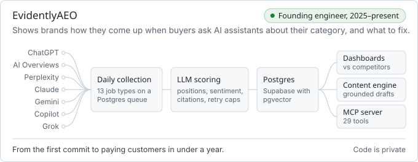

<picture>
  <source media="(prefers-color-scheme: dark)" srcset="assets/header-dark.svg">
  
</picture>

  

<a href="https://evidentlyaeo.com">
<picture>
  <source media="(prefers-color-scheme: dark)" srcset="assets/evidentlyaeo-dark.svg">
  
</picture>
</a>

What I built as founding engineer. The code is private, so this is the shape of it:

- **Job system on Postgres.** Workers claim runs with an atomic update, so a second worker node shares the queue without double-processing. Stuck runs are detected, failed and alerted.
- **MCP server.** OAuth and API-key access, a tenant check on every call, and responses that flag missing data so assistants report gaps instead of inventing metrics.
- **Agency multi-tenancy.** Pooled quotas enforced in Postgres triggers under per-agency advisory locks.
- **Billing.** Stripe checkout and plan entitlements, with idempotent webhooks so a redelivery never provisions twice.

 

<a href="https://github.com/Avaya02/Relay">
<picture>
  <source media="(prefers-color-scheme: dark)" srcset="assets/relay-dark.svg">
  
</picture>
</a>

[Source](https://github.com/Avaya02/Relay) · [relayrun.in](https://relayrun.in) · [`relayrun` on npm](https://www.npmjs.com/package/relayrun)

 

**Stack:** TypeScript, Node.js, React, Next.js, PostgreSQL, Prisma, Claude Agent SDK, MCP

[avayasharma.com](https://avayasharma.com) · [X](https://x.com/Avaya_002) · [LinkedIn](https://linkedin.com/in/avayasharma)
